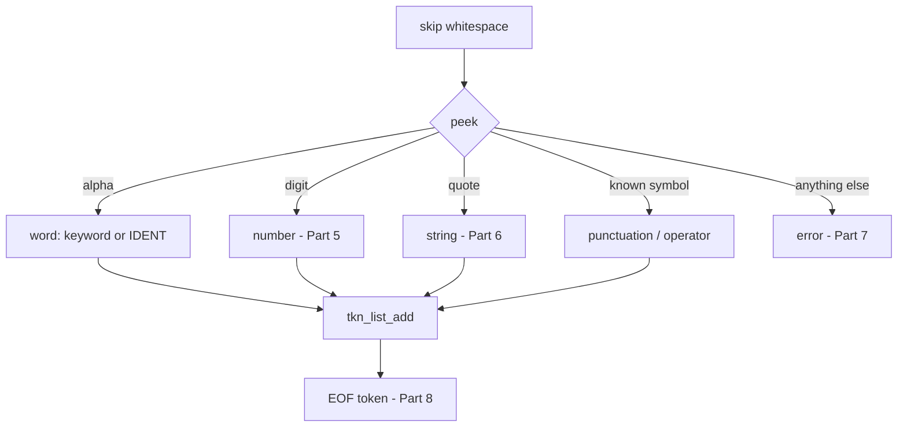

# current — the road to a finished tokenizer

Supersedes the keyword-table card (done 2026-10-25, `5a9a6d1`). This is the whole remaining
path through Chapter 2, in order. The full exercise prose lives in `tokenizer.md`; this card
is the side-by-side version: for each part — the context to hold, the questions that ARE the
implementation, and the checkpoint that says you may move on.

> **Disk state (verified 2026-11-26):** 33 tests, **0 failed**; Parts 1-5 are done and
> committed (keywords, punctuation, operators, identifier spelling, numbers — commits
> `af7c1c6`, `fb348ee`, `bbd234a`, `1adf1fb`). Parts 6-10 are not started. As always: check
> unsaved editor buffers FIRST before writing on top of what is on disk.

## How to run each part

1. Read the part's **Context** — that's what goes in your head.
2. Write the failing test(s) first (one at a time, `make build/tests && timeout 10
   ./build/tests`).
3. Implement — but answer the **Questions** first; writing code for a question you haven't
   answered is how the span bug happened.
4. Checkpoint: new tests green **and** every previous test still green. Then commit.
5. Stuck? Hint bank at the bottom of `tokenizer.md`, section numbered like these parts.
   Stop reading as soon as the next step is clear.

## The invariant you carry through ALL parts

A `Token` is **a span into the source**: `input_string` points at the first byte of the token,
`word_length` says how many bytes belong to it, `start_index` is its offset in the source.
The bytes after the span belong to whatever comes next — or to the whole rest of the source.
Anything that assumes NUL-termination at the token's end (`strlen`, `%s`) is the span bug
waiting to recur. The cursor must always end up exactly one step past the span.

Ask of every new scanner: **which bytes are the token, which bytes does the cursor consume,
and are those the same answer?**

---

## Part 1 — punctuation: `,` `;` `(` `)`

**Context:** `TOKEN_COMMA`, `TOKEN_SEMICOLON`, `TOKEN_LPAREN`, `TOKEN_RPAREN` already exist in
the enum. The `*` branch in `tokenize` is the working template for a one-character token —
read it before writing anything.

**Questions:**
- Four new characters × the same four Token fields — what actually differs between building
  `*` and building `;`? Is the answer four copies of code, or a table + a loop like the one
  you just wrote for keywords?
- Where must these branches sit relative to the silent-skip `else`? What happens to `;` if
  the `else` is checked first?

**Test first:** `";"` → 2 tokens: `TOKEN_SEMICOLON` (pos 0, len 1), EOF. Then each of the
other three. Then `"a,b"` → IDENT, COMMA, IDENT, EOF (4 tokens — count them before running).

**Checkpoint:** all four punctuate; existing 12 stay green. Unknown chars may still be
skipped — that's fixed in Part 7, not here.

## Part 2 — single-char operators: `=` `<` `>`

**Context:** same one-character machinery as Part 1. These are *spelling*: the tokenizer has
no idea what a comparison means.

**Questions:** if Part 1 used a table, do these just… appear in it? If not — why does a
table feel right for 11 keywords + 4 punctuation + 3 operators, but wrong for `*` alone?

**Test first:** `"id=3"` → IDENT, EQ, … wait — `3` isn't a number token yet. So test in
isolation: `"="` → EQ + EOF; then `"<"`, `">"`, and `"a>b"` → IDENT GT IDENT EOF.

**Checkpoint:** six one-character tokens total (`* , ; ( ) = < >` minus still-skipped chars),
nothing else moves.

## Part 3 — two-char operators: `!=` `<=` `>=`

**Context:** the danger is *ordering*: `<` is both a complete token and the prefix of `<=`.
There is no `peek_next` helper yet — but the source is NUL-terminated, and `peek()` past the
end already returns `'\0'`.

**Questions:**
- When you see `<`, what must you inspect **without consuming** to choose between LT and
  LTE? How do you index that byte given what `Lexer` holds?
- What happens if the input is just `"<"` (second byte is `\0`)? Check the branch in your
  head before writing it.
- Which form do you test first — the 2-char or the 1-char? What would "wrong order" do to
  `<=`?
- `!` alone has no enum value. It should reach the Part 7 error path — keep it there.

**Test first:** `"<="` → LTE (len 2!) + EOF. `"<"` → LT + EOF. `">="`, `"!="` likewise. Then
the trap case: `"a<b"` and `"a<=b"` → count and position every token.

**Checkpoint:** the 5-length assert is the one that fails if you consumed one byte when you
should have consumed two.

## Part 4 — identifier spelling: digits and underscores after the first char

**Context:** today a word is `isalpha` only. The guide wants `user_id2` as ONE `TOKEN_IDENT`
— letters/digits/underscore after the first character; the first character itself may not be
a digit. The keyword lookup in `tokenize_word` stays exactly as it is — it receives spans,
not characters.

**The code on disk:** the word-scanning code has two `isalpha` calls:

```c
if (isalpha((unsigned char)peek(&lexer))) {       // byte 1
    while (isalpha((unsigned char)peek(&lexer))) {  // bytes 2..n
```

Both use the *same* predicate. The guide wants: **byte 1** stays `isalpha` (no leading
digit), but **bytes 2..n** also accept digits and underscores. So the two predicates become
**different** — one for the `if`, one for the `while`.

The reason you need both: the `if` asks "is this the start of an identifier?" while the
`while` asks "is this still part of the same identifier?" The first character has stricter
rules than the rest — that's the whole point of the exercise.

**The gotcha:** the broader predicate must still *include* `isalpha`, or you'll exit
immediately after the first char. The broader predicate *subsumes* the stricter one — it
doesn't replace it. And `isdigit`/`isalpha` take an `int` that must be `unsigned char` or
`EOF` — cast: `isdigit((unsigned char)peek(&lexer))`.

**The two decisions Part 4 forces:**

1. **`"_name"`**: the guide bans a leading *digit* and says nothing about a leading
   underscore. Is it legal? The guide is silent → ambiguous spec → make an explicit call,
   write it in a comment, test your decision. (If you allow it, the `if` changes too —
   that's a bigger call with a lasting consequence: `_select` becomes IDENT, not SELECT.)

2. **`"2users"`**: today, `2` is not alpha → falls through to the switch → `default` →
   consumed as unknown (skipped). Then `users` → IDENT. So `"2users"` → IDENT("users") + EOF,
   with `2` dropped. Numbers are Part 5's problem — note the interaction, don't solve it
   twice here.

**Test first:** `"user_id2"` → IDENT len 8. `"users"` stays IDENT len 5 (regression).
Keyword behavior unchanged: `"set"` is still SET, `"seti"` still IDENT.

**Checkpoint:** identifiers contain `_` and digits (not at front); no keyword test moved; no
Part 5 code written. Existing 27 stay green. Then the multi-word guard (already passing)
should still be green after your change.

## Part 5 — numbers

**Context:** `TOKEN_NUMBER`. A number is a run of `isdigit`. The tokenizer recognizes the
spelling; converting bytes to a value is NOT this chapter's job — the parser or b-tree layer
will care. Remember the `unsigned char` cast rule for every `<ctype.h>` call.

**Questions:**
- When does the number run stop? (Hint: the answer is the same shape as "when does the word
  run stop".)
- Where in the dispatch does a digit-led token branch go, and what must it decide before
  Part 4's identifier rule can conflict with it?
- `"2users"` — your decision from Part 4's note, now made real. NUMBER(2) then IDENT(users)?
  Or error? Pick, comment, test.

**Test first:** `"42"` → NUMBER (pos 0, len 2) + EOF. `"id=42;"` → IDENT EQ NUMBER SEMI EOF —
the first test that uses Parts 1–5 together. Assert all five positions.

**On disk now:** both tests are written, registered, and **green** (`1adf1fb`):
`number_42_is_number_then_eof` and `id_eq_42_semi_is_ident_eq_number_semi_eof`. The digit
branch is an `else if (isdigit((unsigned char)peek(&lexer)))` before the punctuation switch,
with a `while (isdigit(...))` run and `tokenize_number` returning `TOKEN_NUMBER`. Span and
cursor behavior are the same shape as the word scanner. Part 5 is closed. Next: Part 6.

## Dispatch map — where each part plugs in



Parts 1-5 are already on disk. Parts 6-7 add branches to the same loop; Part 8 fixes the
list underneath it; Part 9 names what comes out; Part 10 checks the whole machine.

## Part 6 — quoted strings `'…'`

**Context:** `TOKEN_STRING` is in the enum. The guide: the content span **excludes the
quotes** — `"'hello'"` is a STRING of `hello` (5 bytes, `offset_position 1`), not of
`'hello'` (7 bytes). Unterminated → error with the **opening quote's** position. Whitespace
inside quotes is content: the outer `while (isspace(...))` runs only *between* tokens, so
once the string scanner owns the cursor it must not re-skip.

**Exact field names on disk** (`src/tokenizer.h` — do not use the guide's names):
`Token.token_type` (`tokentype`), `Token.input_string`, `Token.word_length`,
`Token.offset_position`. The enum type is lowercase `tokentype`; its error member is
lowercase `token_error`. `TokenList` has `had_error`, `error_msg`, `error_pos`.

**Where the branch goes:** a quote is neither alpha nor digit, so it reaches the `switch
(peek(&lexer))`. Two viable homes — decide by which makes "cursor ends one past the span"
easiest to see:

1. a `case '\'':` in the existing switch, consuming the whole quoted run inside the case
   and setting the local push flag only on success (mind the neighbouring cases' `cursor +=
   1; break;` — no fallthrough);
2. an `else if (peek(&lexer) == '\'')` arm before the switch, symmetric with the number arm,
   keeping the string scanner out of the punctuation switch.

Either passes the tests. Your debugger cares; the test does not.

**The three positions — write them down before coding** (example input `'hello'`):

| Position | Meaning | Value |
|---|---|---|
| opening quote | where the branch began | `starting_offset_position = 0` |
| first content byte | where `Token.input_string` points | `input + 1` |
| closing quote | where scanning stops | index 6 |

Then `word_length = closing_index - opening_index - 2 = 5`, `offset_position = 1`, and the
cursor must end at 7 — one past the closing quote.

**Three traps:**

1. `peek()` past the end returns `'\0'`; the scan loop **must** check `is_at_end(&lexer)` or
   it walks off the buffer (ASan will find it).
2. `word_length` and `offset_position` are `size_t` (unsigned). Computing `cursor - start -
   2` with no closing quote can underflow to a huge number. Check for the close **first**,
   then compute.
3. Empty `''`: closing index = opening+1 → length 0. Valid? Guide silent. Decide, comment,
   test. A zero-length span pointer at `input + 1` is fine.

**Escape rule:** the guide specifies none. Do **not** silently invent backslash or doubled
quote escapes. Record "no escapes in this chapter" in a comment; then `'it''s'` behavior is a
consequence of the chosen scan loop, not a grammar decision. Ask before extending grammar.

**Test first** (all via `tokenize_with` + `ASSERT_EQ_INT` + `token_list_free`):

| Input | Expected |
|---|---|
| `"'hello'"` | 2 tokens: STRING(pos 1, len 5), EOF(pos 7, len 0) |
| `"'a b'"` | STRING(pos 1, len 3, text `a b`), EOF(pos 5) |
| `"''"` | STRING(pos 1, len 0), EOF(pos 2) |
| `"'hi'x"` | STRING(pos 1, len 2), IDENT(pos 4, len 1), EOF(pos 5) — proves the quote does not swallow what follows |
| `"'abc"` (unterminated) | already written and red: `had_error` true and `error_pos == 0` (opening quote). The chosen contract now matches it. |

**Do not use `ASSERT_EQ_STR` on a token span** — `input_string` is not NUL-terminated at
`word_length`; it reads into the rest of the source (the old span bug). Use
`ASSERT_EQ_MEM("hello", t->input_string, t->word_length)`. `ASSERT_EQ_STR` is only for
NUL-terminated values like `token_type_name`'s return (Part 9).

**Debug:** `make scratch ARG="'hello'"` — the harness prints spans with `%.*s` and
`(int)t->word_length`, which is the correct way to view a token.

**Checkpoint:** span excludes quotes; interior whitespace survives; cursor one past the
close; unterminated has a usable position; every previously green test stays green.

## Part 7 — unknown characters become errors

**Context:** this deletes the silent-skip `default:` (`cursor += 1; break;`) — the stopgap
that drops bytes today. On disk: `TokenList` fields `had_error` / `error_msg` / `error_pos`
are initialized to `false` / `"no error\n"` / `0` in `tokenize`; `tokentype` has `token_error`
(lowercase). **This part starts with a decision, not code.**

**The error contract — DECIDED 2026-11-26 by the learner: (a) partial list.** On any error,
`tokenize` returns the list with `had_error = true`, `error_pos` at the offending byte, and
`error_msg` set; the caller frees it normally. The reason he gave: *"so I know where the
error exists"* — the position is the useful artifact, and a `NULL` return destroys it.

| Choice | Observable behavior | Consequence |
|---|---|---|
| **(a) partial list — CHOSEN** | list returned, `had_error = true`, `error_pos` at the bad byte, `error_msg` set; caller frees normally | the REPL can later print `near character '@' at position 6` |
| (b) NULL | free internally, return `NULL` | caller has no list to read `error_pos` from — rejected |

This applies to **both** error kinds: malformed input and allocation failure. The existing
OOM tail — `if (!add_to_list && had_error) { had_error = false; fprintf(stderr,
"errorrrr"); return NULL; }` — is the rejected (b) behavior, half-done: it leaks the list
and buffer and erases the flag. It must be rewritten to return the partial list instead.

**The `error_msg` storage problem:** `error_msg` is a `const char *` with no string buffer
field. Options: (1) point it at a string literal (e.g. `"unexpected character"`) and let the
caller read `input[error_pos]` for the actual byte; (2) add a fixed `char` array to
`TokenList` and `snprintf` into it; (3) a `static` buffer (not reentrant). A local `char
buf[64]` dangles when the function returns. Pick one and document it.

**The sticky-flag trap:** `tkn_list_add` refuses every push once `had_error == true`. Set the
flag inside the loop and the *next* push — including the final EOF push — fails. Ways out:
- stop at the first error and arrange the return to the agreed shape without pushing EOF;
- add a separate lexical-error flag, leaving `had_error` for allocation only;
- change `tkn_list_add` to gate on a local "buffer usable" condition rather than the general
  error flag.

`notes/41` defect 4 ("`had_error` is sticky and overloaded") is why this bites; don't
rediscover it the hard way.

**Other decisions to fill in:** stop at the first error or skip and continue? Does a bad
byte become a `token_error` token or only list metadata? What happens to a lone `!` (Part 3
left it in `default`; there is no `TOKEN_BANG`)? Write the answers down as comments and
tests.

**Test first:**

| Input | Assertion |
|---|---|
| `"SELECT@"` | list non-NULL and freeable; `had_error` true, `error_pos == 6` |
| `"@SELECT"` | error at 0 — position is the offending byte, not the end |
| `"SELECT 42 @ ;"` | error at 10, after valid tokens — earlier tokens were handled |
| `"'abc"` | the Part 6 unterminated case, now using this contract |

If you choose (b), ask how you will assert `error_pos` at all — that friction is the reason
(a) is the easier contract to test and to use from the REPL.

**Checkpoint:** no input is silently mangled; every byte is consumed into a token,
whitespace, or an error. ASan clean on the error path too.

## Part 8 — EOF convention + list robustness

**Context:** `notes/41` defects 2/3/4/6 and the guide's last two checklist items.

**EOF convention:** on disk the final token is
`Token eof_tkn = {TOKEN_EOF, lexer.input_string, 0, lexer.cursor_position};` — pointer at
the source *start*, position at the *end*. The consistent shape is
`{TOKEN_EOF, lexer.input_string + lexer.cursor_position, 0, lexer.cursor_position}`:
pointer and position agree, `word_length = 0`. A one-past-the-end pointer is legal C as long
as it is not dereferenced; `%.*s` with precision 0 does not dereference it.

**Growth path:** `grow_list_capisity` returns `void`, doubles capacity (0→1 guard), uses the
temp variable `new_mem_address` (correct realloc pattern), and sets `had_error = true` on
failure. `tkn_list_add` then refuses all later pushes. Push sites: word, number, punctuation
(after `if (made_punct)`), EOF. Only the EOF push checks the return today — the first three
ignore it, so a grow failure is invisible until the end. Ask: where is the single place that
can free both the buffer and the list object if tokenization cannot continue? (the `tokenize`
error path — currently prints `errorrrr` and returns `NULL` *without* freeing). Part 7's
contract governs this; don't create a second one here.

**OOM testing honesty:** allocation failure is hard to trigger deterministically. Inspect the
path, keep ownership simple, and state in the commit what you reasoned about vs. what you
actually ran. Do not claim an OOM test you did not run.

**Tests:**

| Test | Assertions |
|---|---|
| EOF span for `""` | one token: EOF `offset_position == 0`, `word_length == 0`, `input_string == input + 0` |
| EOF span for `"SELECT"` | EOF `offset_position == 6`, `word_length == 0`, `input_string == input + 6` |
| `token_list_free(NULL);` | no crash — read the function first; it is already NULL-safe, test it anyway |
| 10,000-token input | build `"a "` × 10000 (20,000 bytes + NUL); expect 10,001 tokens; token `2i` is IDENT(pos `2i`, len 1); last is EOF(pos 20000, len 0); free the input buffer and list. Optionally assert `tknlst_capacity >= 10001` to see growth happened. ASan/UBSan clean. |

The stress test is the one that catches dynamic-array bugs: the capacity goes 1, 2, 4, …,
16384 — fourteen `realloc`s. If any write lands outside the current allocation, ASan stops
you at the exact line.

**Checkpoint:** four robustness tests green; no leak from any path.

## Part 9 — `token_type_name`

**Context:** `src/tokenizer.h` lines ~70-73 hold the disabled declaration and the recovery
note (`dev`, commit `0efae80`); `tests/scratch.c` lines ~25-54 hold `scratch_type_name` with
all 27 cases and `default: return "UNKNOWN"`. Recover/move that switch into `tokenizer.c`,
uncomment the declaration, delete the scratch copy, and have the scratch harness call the
real function. Search by *shape* (`scratch_type_name`), not by the target name.

**Decision — names:** enum-style (`"TOKEN_STAR"`) vs display symbols (`"*"`). The guide's
Chapter 3 refactor note (~line 2863) derives default `expect()` messages from this function.
Enum names are unambiguous in tests; symbols read better in REPL errors. Pick one, use it
consistently, write the choice in a comment.

**Decision — `default`:** `tokentype` is an enum, so `-Wall/-Wextra` gives you `-Wswitch`:
a switch missing an enum case is a warning, fatal under `-Werror`. A `default:` case
suppresses that warning — good for bogus `int` values, bad for catching newly added enum
members. Options: (1) keep `default` returning a fallback; (2) omit it, return the fallback
after the switch, and let the compiler tell you when someone adds a token. With `-Werror`,
(2) is a genuine safety net. Choose deliberately; test `(tokentype)999` only if you have a
fallback.

**Test:** two or three assertions, not 27 re-typed ones — e.g. `TOKEN_SELECT`, `TOKEN_EOF`,
and an invalid value if a fallback exists. Use `ASSERT_EQ_STR`: this function returns
NUL-terminated string literals, unlike token spans.

**Checkpoint:** builds clean with the strict flags; scratch output unchanged in meaning; no
duplicate switch left in `tests/scratch.c`. See `notes/42-token-type-name.md`.

## Part 10 — the end-of-chapter checkpoint

**The one test that IS the chapter:** `"SELECT * FROM users WHERE id = 3;"` → ten tokens.
Exact spans (indices verified against the source string):

| # | Type | Pos | Len | Text |
|---|---|---|---|---|
| 0 | SELECT | 0 | 6 | `SELECT` |
| 1 | STAR | 7 | 1 | `*` |
| 2 | FROM | 9 | 4 | `FROM` |
| 3 | IDENT | 14 | 5 | `users` |
| 4 | WHERE | 20 | 5 | `WHERE` |
| 5 | IDENT | 26 | 2 | `id` |
| 6 | EQ | 29 | 1 | `=` |
| 7 | NUMBER | 31 | 1 | `3` |
| 8 | SEMICOLON | 32 | 1 | `;` |
| 9 | EOF | 33 | 0 | — |

Assert all ten types and the count; assert at least three positions (FROM 9, id 26,
SEMICOLON 32) and the EOF length.

**The grammar-free test:** `"FROM SELECT , , ;"` → FROM(0,4), SELECT(5,6), COMMA(12,1),
COMMA(14,1), SEMICOLON(16,1), EOF(17,0): six tokens, no error. If it errors, your tokenizer
is trying to be a parser — delete the check.

**The guide's "Done when"** (`src/minidb-c-guide.md` ~line 2658):

- every statement form you plan to support tokenizes (at least one of SELECT / INSERT /
  CREATE / DELETE / UPDATE shapes);
- every error case sets `had_error` with a usable position (bad char, unterminated string,
  lone `!`);
- `tokenize` knows spelling only, never grammar — the `FROM SELECT` test above;
- no leaks: every `tokenize` in a test has a matching `token_list_free`, ASan clean.

**Final ritual:** run the **whole** suite (`make test`), not just the newest test; update
`todo`, `notes/41-tokenizer-state.md`, `notes/60-open-items.md`, and append a dated
paragraph to `notes/90-log.md`; commit code + tests + notes together and push. Chapter 3
(the parser / AST) starts at guide line 2664.

---

## After EVERY part (the ritual — `AGENTS.md` §8)

- `todo`: tick or restate what moved.
- `notes/41-tokenizer-state.md`: what the lexer handles, defects closed/added.
- `notes/90-log.md`: one dated paragraph — what you did, what surprised you.
- Commit code + tests + notes together, push (`P` or let the hook).

## Commands

```sh
make build/tests && timeout 10 ./build/tests   # build + run (timeout catches a hang)
script -qec ./build/tests /dev/null            # see FAIL lines past ASan noise
make scratch ARG='"SELECT * FROM users;"'       # watch tokens get built, live
```

If a part's questions make you uncomfortable — i.e. you can't guess the shape of the answer —
that's the signal to open `tokenizer.md`'s hint bank for that section, not to skip ahead.
